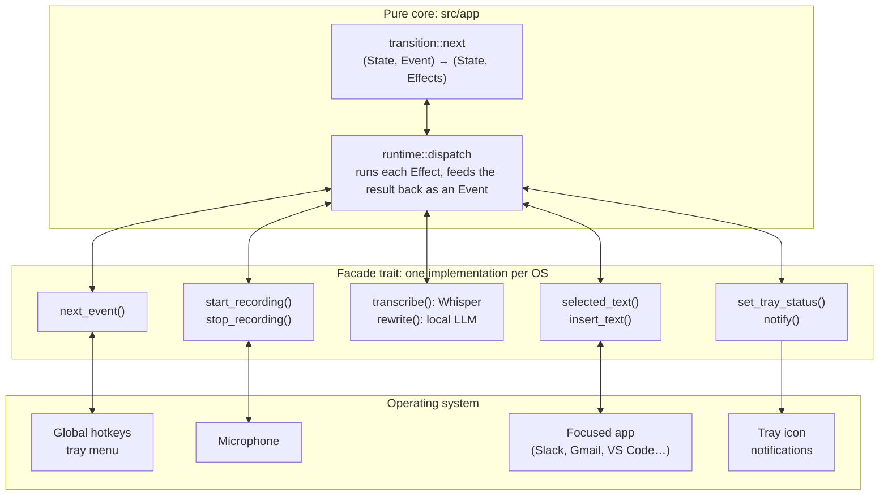
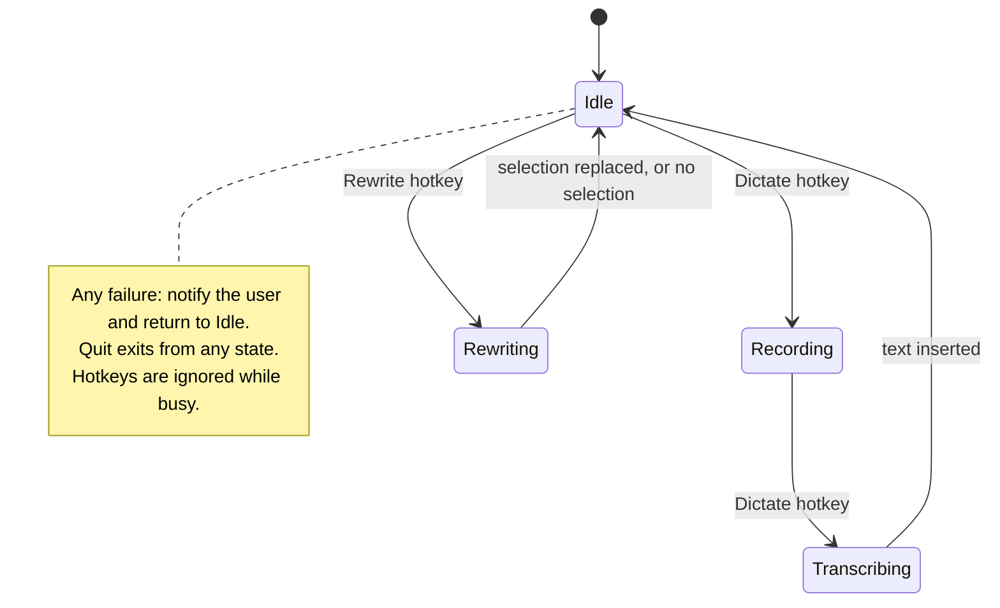

<div align="center">
<h1 align="center">fluentb</h1>
<h3>Fluentb: Your Personal Writing Superpower.</h3>
<a href="https://github.com/dimastatz/fluentb/actions/workflows/ci.yml"></a>


<a href="LICENSE"></a>
<br>
<br>

</div>

## Table of contents

- [About the project](#about-the-project)
- [Features](#features)
- [Privacy](#privacy)
- [Project status](#project-status)
- [Getting started](#getting-started)
- [Usage](#usage)
- [Architecture](#architecture)
- [Roadmap](#roadmap)
- [Contributing](#contributing)
- [License](#license)

## About the project

fluentb makes you faster and clearer in every app you write in. Press a hotkey to dictate straight into any text field (Slack, Gmail, VS Code, Notes), or press another to rewrite what you've typed into clean, fluent, correctly styled text.

It is built in Rust, lives in your system tray, and stays out of your way: no main window, minimal UI, low idle resource use.

## Features

- **Dictate:** speak and have the transcription typed straight into the focused text field.
- **Rewrite:** select text you've written and replace it with a clean, fluent version in the style you choose (neutral, casual, formal, concise).
- **Works everywhere:** any app with a text field. No plugins or integrations needed.
- **Multilingual:** transcription and rewrite keep the language you write in.
- **System tray app:** shows its state (idle, recording, busy) and offers a small menu.

## Privacy

Everything runs on your machine:

- **Transcription** uses [Whisper](https://github.com/openai/whisper) through [whisper.cpp](https://github.com/ggerganov/whisper.cpp).
- **Rewrite** uses a local language model through [llama.cpp](https://github.com/ggerganov/llama.cpp).
- Your audio and text are never sent anywhere. The only network traffic is the one-time model download on first run and an optional update check.
- Logs record events and timings only, never what you said or wrote.

## Project status

fluentb is in **early development**. On macOS, dictation works from the terminal: press the Dictate hotkey, speak, press it again, and the text is typed into the focused app. The tray icon (M4) and Rewrite (M5) are next.

| Platform | Status    |
| -------- | --------- |
| macOS    | Dictation works (terminal app) |
| Windows  | Planned   |
| Linux    | Planned   |

## Getting started

### Prerequisites

- [Rust](https://rustup.rs/) 1.88 or later
- macOS 13 or later
- [CMake](https://cmake.org/) and the Xcode Command Line Tools, to build whisper.cpp (`brew install cmake`, `xcode-select --install`)

### Build from source

```sh
git clone https://github.com/dimastatz/fluentb.git
cd fluentb
cargo build --release
```

### Try dictation

1. Download the speech model (about 142 MB). Until M6 adds automatic downloads, it goes here:

   ```sh
   mkdir -p ~/Library/Application\ Support/fluentb/models
   curl -L -o ~/Library/Application\ Support/fluentb/models/ggml-base.en.bin \
     https://huggingface.co/ggerganov/whisper.cpp/resolve/main/ggml-base.en.bin
   ```

2. Run fluentb from a terminal: `cargo run --release`.
3. Allow your terminal app **Microphone** and **Accessibility** access in System Settings → Privacy & Security when macOS asks. Accessibility is needed to type into other apps.
4. Click into any text field, press `⌘⇧D`, speak, and press `⌘⇧D` again.

Quit with `Ctrl+C` in the terminal.

### Run the checks

These are the checks CI runs on every pull request:

```sh
cargo fmt --all --check
cargo clippy --locked --all-targets -- -D warnings
RUSTDOCFLAGS="-D warnings" cargo doc --locked --no-deps
cargo llvm-cov --locked --all-targets --ignore-filename-regex 'src/main\.rs|src/platform/macos/' --fail-under-lines 95
cargo deny check                                              # cargo install cargo-deny
cargo machete                                                 # cargo install cargo-machete
cargo test -- --ignored   # real Whisper transcription; needs the model downloaded
```

The tools come from `cargo install cargo-llvm-cov cargo-deny cargo-machete`. Coverage excludes the macOS glue (`src/main.rs`, `src/platform/macos/`), which is tested by hand.

CI also checks that the crate builds with the minimum supported Rust version (1.88).

## Usage

> These hotkeys are the planned defaults. The app can't be installed or run yet.

| Action  | Default hotkey | What it does                                              |
| ------- | -------------- | --------------------------------------------------------- |
| Dictate | `⌘⇧D`          | Press to start recording, press again to insert the text. |
| Rewrite | `⌘⇧R`          | Rewrites the selected text and replaces it.               |

On first launch, fluentb downloads the speech and rewrite models and asks for **Microphone** and **Accessibility** permissions. Accessibility access is needed to insert text into other apps.

Settings live in `config.toml`, which fluentb creates with comments on first run:

| OS      | Location                                              |
| ------- | ----------------------------------------------------- |
| macOS   | `~/Library/Application Support/fluentb/config.toml`   |
| Windows | `%APPDATA%\fluentb\config.toml`                       |
| Linux   | `$XDG_CONFIG_HOME/fluentb/config.toml` (or `~/.config/fluentb/config.toml`) |

```toml
version = 1

[hotkeys]
# Cmd means Command on macOS and Ctrl on Windows and Linux.
dictate = "Cmd+Shift+D"
rewrite = "Cmd+Shift+R"

[dictation]
model = "base.en"     # tiny, base, small, medium (optionally .en), or large-v3
language = "auto"     # or a two-letter code such as "en" or "he"
mode = "toggle"       # or "push-to-talk"

[rewrite]
style = "neutral"     # neutral, casual, formal, or concise
```

Any missing or invalid setting falls back to its default, and fluentb shows one notification at startup listing every problem.

## Architecture

fluentb has a pure core with side effects at the edges:

- **State manager:** a pure function `next(state, event) -> (state, effects)` that decides what happens.
- **`Facade` trait** ([`src/facade.rs`](src/facade.rs)): the single boundary to the outside world, covering hotkeys, microphone, Whisper, rewrite engine, text insertion and tray.
- **Platform implementations:** one `Facade` per OS. Tests use a fake implementation, so the core is fully tested without real hardware.



`transition::next` is a pure function that decides what happens. `runtime::dispatch` is the only code that calls the `Facade`, and it feeds each result back into `next` as an `Event`. Audio and text never leave the machine: Whisper and the rewrite model both run locally.

The core moves through these states:



## Roadmap

Each milestone has a PRD in [`docs/specs/`](docs/specs/README.md).

- [x] M0: Foundation (`Facade` trait, CI with coverage gate)
- [x] M1: Pure state manager
- [x] M2: Configuration
- [ ] M3: macOS dictation end to end
- [ ] M4: Tray app shell
- [ ] M5: Local rewrite
- [ ] M6: Model download and first-run onboarding
- [ ] M7: Polish and robustness
- [ ] M8: macOS distribution (signed DMG, Homebrew)
- [ ] M9: Windows support
- [ ] M10: Linux support

## Contributing

Contributions are welcome. Please open an issue to discuss larger changes first.

1. Fork the repository and create a branch.
2. Follow the conventions in [`CLAUDE.md`](CLAUDE.md): functional style, side effects behind the `Facade`, and no `unwrap`/`expect` outside tests.
3. Make sure the [checks](#run-the-checks) pass, and that coverage stays at or above 95%.
4. Open a pull request.

## License

Distributed under the MIT License. See [`LICENSE`](LICENSE) for details.
