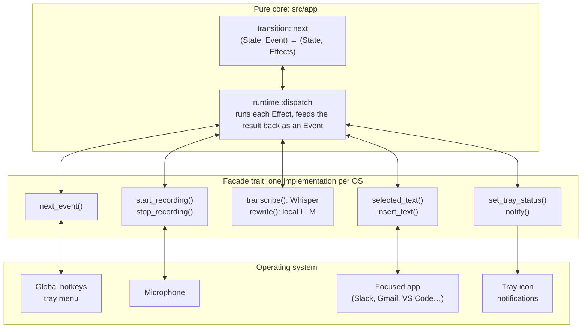
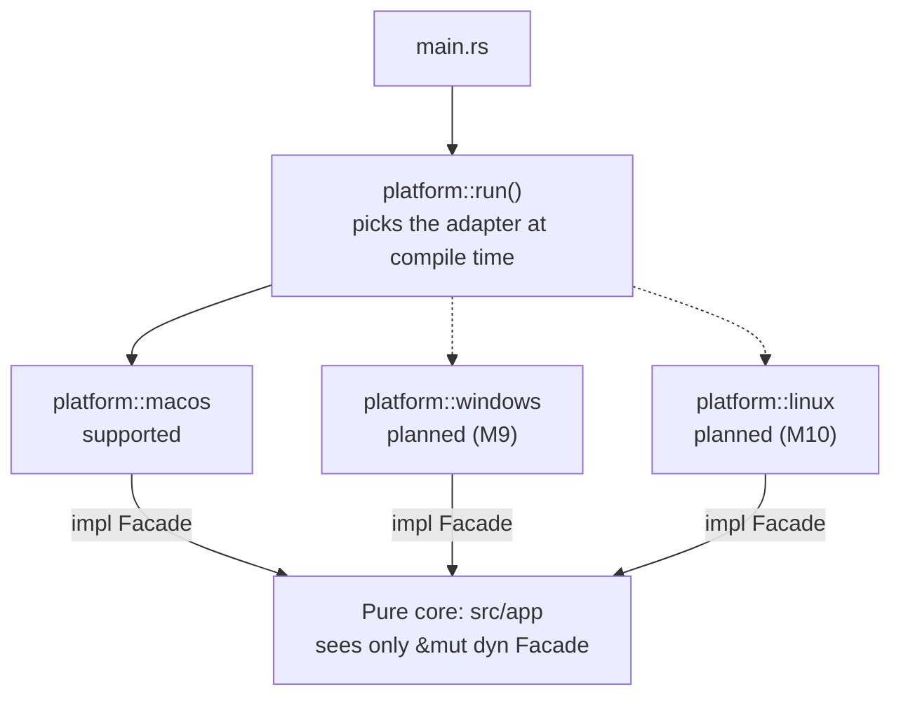
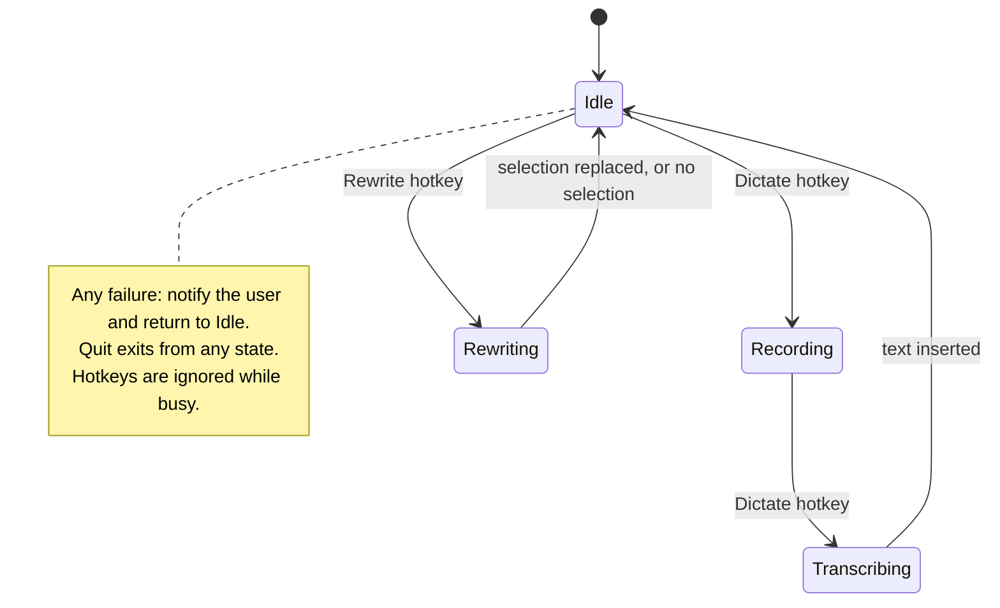

<div align="center">
<h1 align="center">fluentb</h1>
<h3>Fluentb: Your Personal Writing Superpower.</h3>
<a href="https://github.com/dimastatz/fluentb/actions/workflows/ci.yml"></a>


<a href="LICENSE"></a>
<br>
<br>

</div>

## Table of contents

- [About the project](#about-the-project)
- [Features](#features)
- [Privacy](#privacy)
- [Project status](#project-status)
- [Getting started](#getting-started)
- [Usage](#usage)
- [Models](#models)
- [Architecture](#architecture)
- [Roadmap](#roadmap)
- [Contributing](#contributing)
- [License](#license)

## About the project

fluentb makes you faster and clearer in every app you write in. Press a hotkey to dictate straight into any text field (Slack, Gmail, VS Code, Notes), or press another to rewrite what you've typed into clean, fluent, correctly styled text.

It is built in Rust, lives in your system tray, and stays out of your way: no main window, minimal UI, low idle resource use.

## Features

- **Dictate:** speak and have the transcription typed straight into the focused text field.
- **Rewrite:** select text you've written and replace it with a clean, fluent version in the style you choose (neutral, casual, formal, concise).
- **Works everywhere:** any app with a text field. No plugins or integrations needed.
- **Small by default:** fluentb targets English and downloads about 475 MB of models on first run. Larger, more accurate models (including multilingual ones) are one menu click away.
- **System tray app:** shows its state (idle, recording, busy) and offers a small menu.

## Privacy

Everything runs on your machine:

- **Transcription** uses [Whisper](https://github.com/openai/whisper) through [whisper.cpp](https://github.com/ggerganov/whisper.cpp).
- **Rewrite** uses a local language model through [llama.cpp](https://github.com/ggerganov/llama.cpp).
- Your audio and text are never sent anywhere. The only network traffic is downloading the models on first run (or when you switch models) and an optional update check. Downloads are plain requests to Hugging Face and send nothing about you:
  - Speech: `https://huggingface.co/ggerganov/whisper.cpp/resolve/main/ggml-<model>.bin`
  - Rewrite: `https://huggingface.co/unsloth/Qwen3-0.6B-GGUF/…`, `unsloth/Qwen3-1.7B-GGUF/…`, `Qwen/Qwen3-4B-GGUF/…` and `ggml-org/gemma-3-4b-it-GGUF/…`

  Each file is checked against its published SHA-256 before use. The full list is in [`src/models.rs`](src/models.rs).
- Logs record events and timings only, never what you said or wrote.

## Project status

fluentb is in **early development**. On macOS, it runs in the menu bar, downloads its models on first run, and both hotkeys work. Dictation types what you say into the focused app, and rewrite replaces the selected text with a polished version from a local model. Polish (M7: push-to-talk, Esc to cancel, sounds, logs, launch at login) is in review, and a signed app (M8) is next.

| Platform | Status    |
| -------- | --------- |
| macOS    | Dictation and rewrite work (menu-bar app, built from source) |
| Windows  | Planned   |
| Linux    | Planned   |

## Getting started

### Prerequisites

- [Rust](https://rustup.rs/) 1.90 or later
- macOS 13 or later
- [CMake](https://cmake.org/) and the Xcode Command Line Tools, to build whisper.cpp (`brew install cmake`, `xcode-select --install`)

### Build from source

```sh
git clone https://github.com/dimastatz/fluentb.git
cd fluentb
cargo build --release
```

### Try it

1. Run fluentb from a terminal: `cargo run --release`.
2. On first run, fluentb:
   - shows a welcome notification;
   - asks for **Microphone** and **Accessibility** access (allow both for your terminal app; Accessibility is needed to read and type text in other apps);
   - downloads its [models](#models) in the background, about 475 MB in all: the speech model (78 MB) first, then the rewrite model (397 MB).

   The menu shows the progress, and a notification says when each hotkey is ready.
3. **Dictate:** click into any text field, press `⌘⇧D`, speak, and press `⌘⇧D` again.
4. **Rewrite:** select some text in any app and press `⌘⇧R`.

fluentb shows a microphone in the menu bar: an outline when idle, red while recording, and three dots while transcribing. Its menu:
- lists your hotkeys;
- switches the speech and rewrite models (downloading them if needed);
- removes models you no longer use;
- warns about missing permissions;
- opens the config, and quits the app.

Only one copy runs at a time.

### Run the checks

These are the checks CI runs on every pull request:

```sh
cargo fmt --all --check
cargo clippy --locked --all-targets -- -D warnings
RUSTDOCFLAGS="-D warnings" cargo doc --locked --no-deps
cargo llvm-cov --locked --all-targets --ignore-filename-regex 'src/main\.rs|src/platform/macos/' --fail-under-lines 95
cargo deny check                                              # cargo install cargo-deny
cargo machete                                                 # cargo install cargo-machete
cargo test --release -- --ignored   # real transcription and rewrite; needs the default models downloaded
```

The tools come from `cargo install cargo-llvm-cov cargo-deny cargo-machete`. Coverage excludes the macOS glue (`src/main.rs`, `src/platform/macos/`), which is tested by hand.

CI also checks that the crate builds with the minimum supported Rust version (1.90).

## Usage

| Action  | Default hotkey | What it does                                              |
| ------- | -------------- | --------------------------------------------------------- |
| Dictate | `⌘⇧D`          | Press to start recording, press again to insert the text. |
| Rewrite | `⌘⇧R`          | Rewrites the selected text and replaces it.               |

On first launch, fluentb downloads the speech and rewrite models and asks for **Microphone** and **Accessibility** permissions. Accessibility access is needed to read and insert text in other apps. Dictation works as soon as the speech model is ready; you don't have to wait for the rewrite model.

Settings live in `config.toml`, which fluentb creates with comments on first run:

| OS      | Location                                              |
| ------- | ----------------------------------------------------- |
| macOS   | `~/Library/Application Support/fluentb/config.toml`   |
| Windows | `%APPDATA%\fluentb\config.toml`                       |
| Linux   | `$XDG_CONFIG_HOME/fluentb/config.toml` (or `~/.config/fluentb/config.toml`) |

```toml
version = 1

[hotkeys]
# Cmd means Command on macOS and Ctrl on Windows and Linux.
dictate = "Cmd+Shift+D"
rewrite = "Cmd+Shift+R"

[dictation]
model = "auto"        # tiny.en; or tiny, base, small, medium (optionally .en), large-v3
language = "auto"     # or a two-letter code such as "en" or "he"
mode = "toggle"       # or "push-to-talk"
sounds = true         # a short sound when recording starts and stops
max_recording_seconds = 120

[rewrite]
style = "neutral"     # neutral, casual, formal, or concise
model = "auto"        # qwen3-0.6b; or qwen3-1.7b, qwen3-4b, gemma3-4b
unload_after_minutes = 10  # free the model's memory when idle
keep_loaded = false
max_characters = 4000
```

Any missing or invalid setting falls back to its default, and fluentb shows one notification at startup listing every problem.

## Models

fluentb targets **English** and, to keep the download small, uses the smallest models by default:

| | Default | Size | Source (Hugging Face) | Licence |
| --- | --- | --- | --- | --- |
| Speech | `tiny.en` (Whisper, English only) | 78 MB | `ggerganov/whisper.cpp` | MIT |
| Rewrite | `qwen3-0.6b` (Qwen3 0.6B, Q4_K_M) | 397 MB | `unsloth/Qwen3-0.6B-GGUF` | Apache 2.0 |

That's about **475 MB** on first run. The small models are fast (a rewrite takes well under a second on Apple Silicon), but they are less accurate. In particular, `qwen3-0.6b` sometimes drops part of a sentence when it rewrites; see [the evaluation](eval/rewrite/RESULTS.md). If that matters to you, switch to a larger model from the tray menu, or set `model` in `config.toml`:

| Speech | Size | Rewrite | Size |
| --- | --- | --- | --- |
| `tiny` (multilingual) | 78 MB | `qwen3-1.7b` | 1.1 GB |
| `base`, `base.en` | 148 MB | | |
| `small`, `small.en` | 488 MB | `qwen3-4b` (best quality) | 2.5 GB |
| `medium`, `medium.en` | 1.5 GB | `gemma3-4b` | 2.5 GB |
| `large-v3` (multilingual) | 3.1 GB | | |

A model is downloaded only when you choose it, and "Remove unused models" in the menu deletes the ones you no longer use. Models live in `~/Library/Application Support/fluentb/models/`.

## Architecture

fluentb has a pure core with side effects at the edges:

- **State manager:** a pure function `next(state, event) -> (state, effects)` that decides what happens.
- **`Facade` trait** ([`src/facade.rs`](src/facade.rs)): the single boundary to the outside world, covering hotkeys, microphone, Whisper, rewrite engine, text insertion and tray.
- **Platform adapters:** one `Facade` per OS, all under [`src/platform/`](src/platform/). Tests use a fake implementation, so the core is fully tested without real hardware.



`transition::next` is a pure function that decides what happens. `runtime::dispatch` is the only code that calls the `Facade`, and it feeds each result back into `next` as an `Event`. Audio and text never leave the machine: Whisper and the rewrite model both run locally.

### Platform adapters

fluentb is designed for several operating systems from the start. The `Facade` trait is a strategy, and each OS provides an adapter that implements it:



- **All platform code in one place.** Everything OS-specific lives under `src/platform/`, one module per OS, together with its OS-only dependencies.
- **One selection point.** `platform::run()` chooses the adapter for the OS the binary is built for. Nothing outside `src/platform/` checks the target OS.
- **Thin adapters.** Logic that differs by OS but needs no OS API (key mapping, file paths) is a pure function that takes an `Os` value, so every OS's behaviour is tested on any machine.
- **Adding an OS** means adding a new adapter. The core and the other adapters don't change.

### States

The core moves through these states:



## Roadmap

Each milestone has a PRD in [`docs/specs/`](docs/specs/README.md).

- [x] M0: Foundation (`Facade` trait, CI with coverage gate)
- [x] M1: Pure state manager
- [x] M2: Configuration
- [ ] M3: macOS dictation end to end
- [ ] M4: Tray app shell
- [ ] M5: Local rewrite
- [ ] M6: Model download and first-run onboarding
- [ ] M7: Polish and robustness
- [ ] M8: macOS distribution (signed DMG, Homebrew)
- [ ] M9: Windows support
- [ ] M10: Linux support

## Contributing

Contributions are welcome. Please open an issue to discuss larger changes first.

1. Fork the repository and create a branch.
2. Follow the conventions in [`CLAUDE.md`](CLAUDE.md): functional style, side effects behind the `Facade`, and no `unwrap`/`expect` outside tests.
3. Make sure the [checks](#run-the-checks) pass, and that coverage stays at or above 95%.
4. Open a pull request.

## License

Distributed under the MIT License. See [`LICENSE`](LICENSE) for details.
